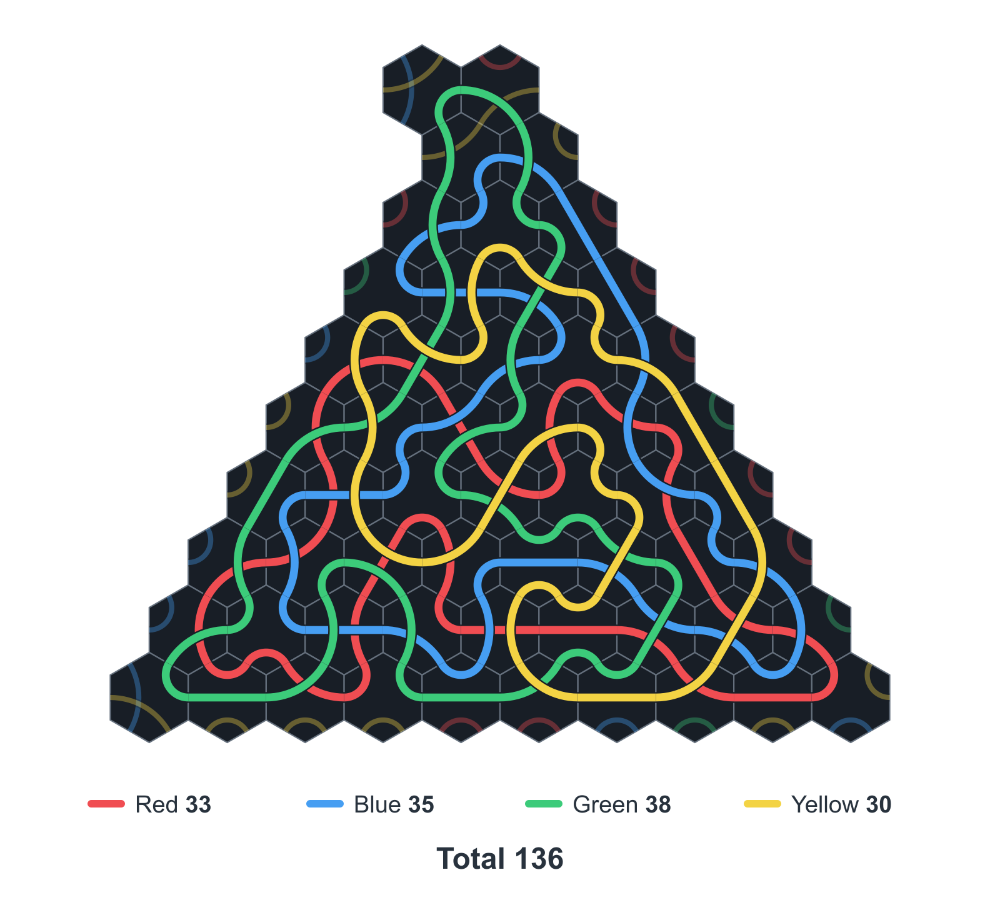
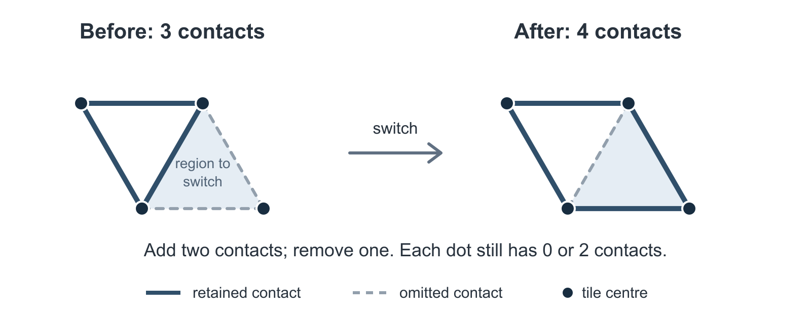

# Tantrix: why 136 is optimal

Tantrix uses hexagonal tiles, each carrying three paths of different colours. The full set contains 56 tiles and uses four colours: red, blue, green and yellow. Each path joins two sides of its tile. Jaap Scherphuis's introduction on his [puzzle site](https://www.jaapsch.net/puzzles/tantrix.htm) describes the tiles and lists their patterns.

The best possible score in Tantrix's Four Longest Loops puzzle is **136**, using all 56 tiles with matching colours and no holes.

Arrangements scoring 136 have been known for many years. This project explains why no other arrangement can do better.

I came to this problem through Jaap Scherphuis's Tantrix page. His sketch explains why 136 should be optimal, but leaves the comparison with every other shape unproved. That prompted me to develop a proof and gave me a starting point.

[](assets/tantrix-136.svg)

*Milan Kuchtiak's 136 configuration, drawn from the checked tile and loop data. The four scored loops are highlighted; other paths are dimmed. [Historical construction and tile inventory recorded by Jaap Scherphuis](https://www.jaapsch.net/puzzles/tantrix.htm). Click the image for the scalable diagram.*

## The puzzle

In **Four Longest Loops**, the aim is to make the longest possible combined total of four closed loops, one of each colour. The rules used in the proof are:

- Use each of the 56 numbered tiles exactly once, placed on the hexagonal grid.
- Tiles may be rotated, but not reflected.
- Colours must match across every shared side, including contacts outside the scored loops.
- Leave no enclosed empty cells: every empty cell must have a route to the outside through empty neighbouring cells.

A loop's length is the number of tiles it passes through. Only the longest closed loop of each colour counts, and the score is the sum of those four lengths. A tile used by two scored colours contributes once to each, so the total can exceed 56. The [official puzzle description](https://www.tantrix.com/english/TantrixUnsolved.html) gives the scoring rule and the requirement to match colours and leave no holes.

## Background

The official Tantrix history dates the Four Longest Lines and Four Longest Loops puzzles to 1993. In September 1998, **Milan Kuchtiak** reported a computer-assisted construction scoring 136, arranged as a triangle with one attached tile. In March 2003, **Jack Kuipers** also achieved 136 without computer assistance. [Official history](https://www.tantrix.com/english/TantrixUnsolved.html)

## The result

**No arrangement of the 56 tiles satisfying the rules above can score more than 136.** This holds for every shape, including arrangements split into separate groups of tiles, provided there are no holes.

Kuchtiak's construction shown above attains this bound, so **136 is the exact maximum**. Lean checks both the general upper bound and the validity of that full-set coloured construction.

## The idea of the proof

For the full argument, see [proof.md](proof.md) and its [technical details](technical-details.md).

The starting point is [Jaap Scherphuis's sketch](https://www.jaapsch.net/puzzles/tantrix.htm): count the tile sides that the loops cannot use. The extra step is to show that changing the shape cannot reduce this loss enough to beat 136.

### 1. Count the sides the loops cannot use

The 56 tiles have 336 sides altogether. A loop uses two sides of each tile it visits, so the total score is half the number of tile sides used by the four loops.

Exposed sides cannot contribute to a closed loop. Where two tiles touch, their shared sides form a **contact**. If none of the four scored loops uses that contact, another two tile sides are lost from the count.

In the displayed construction, 62 sides are exposed and one contact is unused by the four loops. That leaves $336-62-2=272$ usable sides, giving a score of $272/2=136$.

A more compact shape might expose fewer sides, but force more contacts to go unused. We need to show that these two losses always add up to **at least 64 tile sides**.

### 2. Use the fact that loops enter and leave

Every time a loop enters a tile, it must also leave. The number of contacts used at each tile is therefore even. A tile touching five neighbours, for example, must leave at least one contact unused.

Draw each used contact as a line joining the two tile centres. An even number of lines meets at every centre; call this an **even network**. Its number of lines equals the score, since each closed loop crosses as many contacts as it visits tiles, and different colours cannot share a contact.

For a fixed tile arrangement, choose the largest possible even network, allowing even those that the actual coloured paths could not make. This can only increase the maximum, so an upper bound for it also bounds the puzzle.

Let $S$ count exposed sides and $d$ count contacts left out of this largest network. Its size is

$$
M=\frac{336-S}{2}-d=168-\frac{S+2d}{2}
$$

and our target is $S+2d\ge64$.

### 3. Try to improve the network

Three mutually touching tiles make a little triangle between their centres. In a hole-free arrangement, every even network can be drawn as the boundary of a collection of these triangles: shade them so that used contacts have shading on just one side, while unused contacts have shading on both sides or neither.

The no-holes condition guarantees that every shaded triangle has a tile centre at each corner. A contact beside no such triangle must therefore be unused.

Now take any collection of these little triangles. Along its boundary, **switch** used contacts to unused ones and unused contacts to used ones. Switching one triangle changes two contacts at each corner, keeping every count even. Switching several does the same: any shared edge is switched twice and returns to its original state.

If the boundary had more unused contacts than used ones, this would add more lines than it removed. That is impossible in a largest network. Hence:

> Around any such collection of triangles, at least half the boundary contacts must be used.

[](assets/boundary-switch.svg)

*Here the shading marks the region to switch. Switching its boundary gains one contact while preserving evenness. Such an improvement is impossible in a maximum network.*

### 4. Compare how much space the boundaries can enclose

A short boundary can enclose only a limited number of little triangles. The proof gives a precise area bound for this grid, keeping track of whether the triangles just inside the boundary point upwards or downwards. Counting the three sides of each triangle also restricts which boundary counts are possible. These facts apply even when a collection has separate pieces or holes.

To bring unused contacts into this area calculation, divide all the little triangles formed by touching tiles into two groups: shaded upward triangles go with unshaded downward triangles, and the rest go in the other group.

Neighbouring triangles point in opposite directions. Across a used contact their shading also changes, so they stay in the same group. Across an unused contact their shading stays the same, so they fall in different groups. **The unused contacts between triangles are therefore exactly the boundaries between the two groups.**

Apply the area bound and the switching rule to both groups. Together they contain all the triangles, so this limits how much area is possible for a given outside boundary and number of unused contacts.

### 5. Rule out a score of 137 or more

A score of at least 137 would require $S+2d\le62$. For a 56-tile arrangement in one piece, counting contacts tells us how many little triangles must be present. But with so few exposed sides and unused contacts, the area and boundary constraints for the two groups allow fewer triangles than that count requires.

The [final calculation](proof.md#4-two-budget-cases-finish-the-proof) makes this contradiction explicit in two short cases. Thus $S+2d\ge64$, leaving at most $336-64=272$ sides for loops, and a score of at most **136**.

The argument also covers [disconnected arrangements](proof.md#5-disconnected-supports), with the same no-holes condition. Kuchtiak's construction attains 136, so the bound is exact.

## Earlier proof sketches and claims

The official historical account records Kuchtiak's statement that 136 was optimal for his particular shape, while optimality over all shapes still needed to be proved. The page, last updated in July 2017, describes 136 as the assumed maximum. [Official history](https://www.tantrix.com/english/TantrixUnsolved.html)

**Jaap Scherphuis** gives a proof sketch based on the arrangement's perimeter and the internal contacts that cannot be used by loops. It explains why the triangular construction is promising, but leaves the comparison with every other shape unfinished. His account explicitly says: “I have not properly proved this.” [Jaap's proof sketch](https://www.jaapsch.net/puzzles/tantrix.htm)

**Keith L. Downing's 2005 paper**, *Tantrix: A Minute to Learn, 100 (Genetic Algorithm) Generations to Master*, reports that computer analyses gave maxima of 146 and 136, citing the Tantrix manual in Section 3.4. The available author manuscript gives neither a proof of the 136 bound nor a reference identifying the underlying analysis. [Published article](https://doi.org/10.1007/s10710-005-4803-x), [author manuscript](https://www.tantrix.com/english/downloads/GAPaper.pdf)

Jamie Sneddon's [published proof of the 146 bound](https://www.tantrix.com/english/downloads/ProofUnsolvedPuzzle.pdf) concerns Four Longest Lines, not Four Longest Loops which requires its own upper-bound argument.

A search of the literature, web and GitHub on 8 October 2026 found no earlier complete public proof of the global 136 bound. Earlier work may exist in unindexed sources or private correspondence.

## Verification in Lean

Lean is a proof assistant whose kernel checks the logical steps of a formal proof. The final theorem, in [ColouredSharpness.lean](lean/Tantrix/ColouredSharpness.lean), is:

```text
Tantrix.Loops.full_set_optimum_136
```

It states that 136 is the greatest score attainable under the rules above.

The [Lean reading guide](lean/README.md#reading-guide) connects each step of the written proof to the main files and theorems.

Follow the [setup instructions](lean/README.md#first-run), then run this from the package root:

```sh
bash lean/verify.sh
```

GitHub Actions also rebuilds the proof and runs the dependency audit and kernel check on every push.

[](https://github.com/renidrag/tantrix-136-proof/actions/workflows/verify.yml)

<details>
<summary>Verification details</summary>

The included Lean sources passed their full build and all 244 guarded dependency checks on 10 October 2026, using Lean 4.34.1 and Mathlib revision `d13f23b723b8a846827a245b89c10fc7d3f11612`. The build treats warnings as errors. The dependency audit permits only Lean's standard foundations `propext`, `Classical.choice` and `Quot.sound`; the proof uses no placeholders, custom axioms or native-computation proof shortcuts.

Lean checks the definitions and tile catalogue used in the proof. Their correspondence to the physical puzzle is part of checking the model.

</details>

## Attribution

This proof package was prepared by **Rob Gardiner**. OpenAI language models substantially assisted the mathematical development, formalisation, counterexample searches, checking and writing. The package has not yet undergone independent human review.

The coloured construction is credited to **Milan Kuchtiak**. **Jaap Scherphuis's** numbered tile inventory and published diagram supply the data used by the certificate, and his perimeter-and-parity sketch supplies the starting mathematical intuition. **Jack Kuipers's** unaided achievement is part of the puzzle's history.

## Licence

The Lean code, text and figures in this package are available under the [MIT licence](LICENSE).
